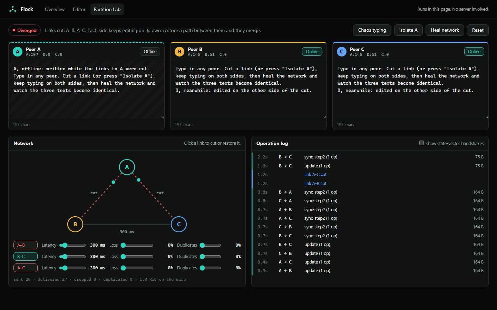
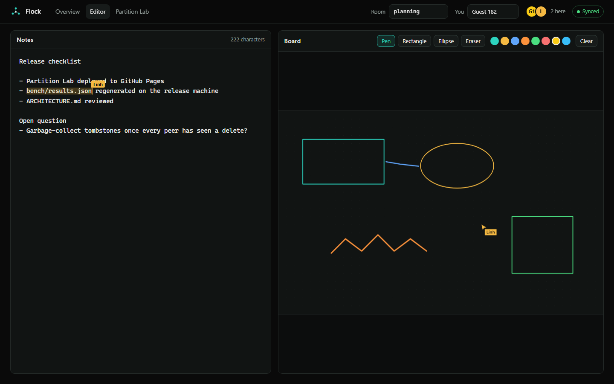

<p align="center"></p>

# Flock

[](https://github.com/TIENDUNG21/flock-realtime-collab/actions/workflows/ci.yml)
[](LICENSE)

<p align="center"></p>

Flock is a local-first collaboration engine for plain text and key-value data: a sequence CRDT and
a last-writer-wins map written from scratch in TypeScript, a sync protocol built on state vectors,
a WebSocket relay that persists each room to an append-only log, and a browser editor with a shared
whiteboard and live cursors.



The [Partition Lab](https://tiendung21.github.io/flock-realtime-collab/lab.html) runs three
replicas in one page over a simulated network. In the screenshot, both links to peer A are cut; A
keeps editing on its own while B and C stay in sync. Restoring either link merges all three. Links
can be given latency, loss and duplication, and `?scenario=chaos` starts random typing over a lossy
link. Nothing in the lab talks to a server.

## Usage

Two replicas edit concurrently without coordination, then exchange only what the other is missing:

```ts
import { Doc } from '@flock/crdt';

const alice = new Doc({ replicaId: 'alice' });
const bob = new Doc({ replicaId: 'bob' });
alice.getText('note').insert(0, 'Hello');
bob.applyUpdate(alice.encodeStateAsUpdate());

alice.getText('note').insert(5, ', world'); // concurrent edits,
bob.getText('note').insert(0, 'Draft: '); //   no coordination

alice.applyUpdate(bob.encodeStateAsUpdate(alice.stateVector()));
bob.applyUpdate(alice.encodeStateAsUpdate(bob.stateVector()));
alice.getText('note').toString(); // 'Draft: Hello, world'
bob.getText('note').toString(); //   'Draft: Hello, world'
```

This exact sequence runs as a test (`packages/crdt/test/readme.test.ts`). Against the server, a
`WebSocketProvider` does the exchange continuously and reconnects on its own:

```ts
import { Doc } from '@flock/crdt';
import { Awareness, WebSocketProvider } from '@flock/sync';

const doc = new Doc();
const awareness = new Awareness(doc.replicaId);
new WebSocketProvider('ws://localhost:5130', 'planning', doc, { awareness });
awareness.setLocalState({ name: 'Linh', color: '#f5b942' });
```

The editor is a Vite app that needs the relay running locally:

```sh
npm ci
npm run server     # ws://127.0.0.1:5130, rooms stored in ./data
npm run dev:web    # open http://localhost:5135/editor.html#planning in two windows
```



The second participant above is a real client connected through the server. The editor keeps each
room in `localStorage`, so it also works with the server stopped and merges when it comes back.
The packages are not published to npm; they are used from this workspace.

## How it works

**Text is an RGA** (Roh et al., 2011). Every character is an item with an id `(replica, seq)`, a
Lamport timestamp and an origin: the id of the character it was typed after. A new item is placed
right after its origin, skipping following items whose `(lamport, replica)` stamp is greater than
its own. Because a Lamport clock gives every item a larger stamp than anything it causally follows,
the skipped items are exactly the concurrent siblings that win the tie and their descendants, so
every replica arrives at the same order whatever order the inserts arrive in. Deleting marks an item
as a tombstone; it stays in the list so that later inserts can still refer to it. Items are stored
per code point, so an emoji is never split, while the public API uses UTF-16 offsets like
JavaScript strings. Cursors are kept as positions relative to item ids and survive concurrent edits.

**Sequence numbers are consecutive per replica**, separate from the Lamport time. That makes a state
vector (replica to highest `seq`) an exact description of which operations a replica holds, and a
delta is simply "every operation above the other side's vector". A received operation is applied
only when it is the next one from its replica and its origin or delete targets are known; anything
else waits in a buffer. Duplicates are recognised by id. Any delivery order, with any duplication,
produces the same document, which is the property the tests check directly.

**Maps are last-writer-wins registers** keyed by string, ordered by the same `(lamport, replica)`
stamp. Deletes are tombstones with a stamp, so an older concurrent write cannot bring a key back.
The whiteboard stores each shape as one map entry, which makes concurrent drawing conflict-free and
erasing a key deletion.

**Updates are binary.** Operations are grouped by replica with implicit sequence numbers, Lamport
times are delta-coded, strings go through a table, and "typed after my previous character" costs one
flag bit. A keystroke encodes to 3 bytes, against 138 bytes as JSON. The decoder checks every
bound and reports malformed input as a `DecodeError` with the byte offset; it never throws anything
else on arbitrary bytes (fuzzed, see below).

**The protocol has four messages**: `sync-step1` (my state vector), `sync-step2` (what you are
missing), `update` (new operations) and `awareness` (presence, highest clock wins, 30 s timeout).
A `SyncSession` runs one link: it handshakes on connect, queues local operations while
disconnected, re-sends its state vector periodically to repair lost messages, and asks again early
when an update arrives with a gap. Sessions forward everything that did not come from their own
link, so the same code relays through the server and across the lab's three-peer mesh.

**The server is a peer.** Each room holds a replica of the document and one session per client, so
it can answer any state vector with a delta. New operations are appended to `data/<room>.flog` as
`[length][crc32][update]` records. On open the log is replayed; a torn or corrupt tail record is cut
off. After 1000 records the log is rewritten as one snapshot through a temporary file and a rename.

[`docs/ARCHITECTURE.md`](docs/ARCHITECTURE.md) follows one keystroke through every layer and
documents the wire and file formats. The design decisions are recorded in [`docs/adr`](docs/adr).

## Tests

207 tests run with Vitest, on Linux in CI and on Windows locally. The ones that carry the weight of
the convergence claim are property tests written with fast-check:

- 3 to 5 replicas make random concurrent text and map edits (including astral characters and
  combining marks), and operations are delivered out of order, late and duplicated. After a final
  flush every replica has the same text, tombstone order, map values and state vector (250 runs).
- Re-applying every operation changes nothing, and merging two histories in either order gives the
  same state (100 and 150 runs). A single replica matches a plain JavaScript string model (200 runs).
- Three simulated peers go through random edits, partitions, loss, duplication and latency changes,
  then the network heals and they must converge (60 runs). A separate test shows that a lost final
  update on a live link is recovered only by anti-entropy.
- The update decoder rejects every truncation of a valid update and 2000 random or mutated inputs
  with `DecodeError`.

The server is tested with real WebSocket clients on a real port: concurrent edits from three
clients, one client going offline and replaying, presence relay and removal, a restart under live
clients, and a cold restart where a new client gets the whole room from disk.

## Performance

Measured with `npm run bench` (median of 5 runs after a warm-up) on an Intel i7-14700K with 32 GB
RAM, Windows 11, Node 22.19. Raw output is in [`bench/results.json`](bench/results.json).

| Benchmark                                           | Operations |   Median |   Ops/s |
| --------------------------------------------------- | ---------: | -------: | ------: |
| Local typing, appending one character per operation |    100,000 |  72.1 ms |  1.39 M |
| Local inserts and deletes at random positions       |     20,000 | 335.3 ms |  59,651 |
| Decode and integrate a remote update                |    100,000 |  46.9 ms |  2.13 M |
| Merge two concurrent branches into a third          |     20,000 |   8.3 ms |  2.40 M |
| Map writes                                          |    100,000 |  57.2 ms |  1.75 M |
| Keystrokes replicated A to B through `SyncSession`  |     20,000 |  71.0 ms | 281,541 |

| Trace                   | Operations |    Binary |         JSON | Bytes per op |
| ----------------------- | ---------: | --------: | -----------: | -----------: |
| Typing                  |    100,000 | 300,018 B | 13,766,657 B |         3.00 |
| Random inserts, deletes |     20,000 | 120,201 B |  2,695,051 B |         6.01 |

Local edits at random positions are the slow case because finding a UTF-16 offset walks the linked
list from the last edit position. Remote operations never search by offset (they name their origin
by id), which is why integrating them is an order of magnitude faster.

## Limitations

Tombstones are never collected. After typing 100,000 characters and deleting half, the full state
is still 300,025 bytes for 50,000 visible characters, and the operation log grows the same way.
Collecting them safely requires knowing that every replica has seen a delete, which the protocol
does not track.

Position lookup is linear. A tree of items indexed by visible length would make local edits
O(log n); it is not implemented.

RGA avoids interleaving words typed forwards at the same spot, but text typed backwards (each
character inserted before the previous one) by two users at the same position interleaves, as
described by Kleppmann et al. (2019). A test pins the current behaviour.

There is no rich text, no undo, and map values are replaced whole: two users editing different
fields of the same shape keep only the later write. The textarea binding replaces the whole value on
each remote change, which is fine for notes-sized documents and can disturb an IME composition in
progress.

The relay is a single process with no authentication: anyone who can reach it can read and write
any room. By default appends are not fsynced (`FLOCK_FSYNC=1` turns that on). The editor on GitHub
Pages has no server to talk to and keeps rooms in `localStorage` only.

A replica id must never be reused for two independent histories; the editor generates a new one on
every page load.

## Roadmap

Not implemented, in rough order of value: tombstone collection once a delete is causally stable
across known replicas, a tree index over items for O(log n) offsets, per-user undo, authenticated
rooms on the relay, and a binding for `contenteditable` with formatting marks.

## Building from source

Node 22.12 or newer. All commands run from the repository root:

```sh
npm ci
npm test               # Vitest, all packages
npm run typecheck      # tsc --build plus the web app and tests
npm run lint           # ESLint with type information
npm run build          # packages, server, bench and the web app
npm run build:pages    # web app with base /flock-realtime-collab/, checked by a script
npm run bench          # writes bench/results.json
```

The server reads `PORT` (5130), `HOST` (127.0.0.1), `DATA_DIR` (`./data`), `FLOCK_FSYNC`,
`FLOCK_COMPACT_EVERY` (1000) and `FLOCK_ALLOWED_ORIGINS` (comma-separated; unset accepts any
origin). The editor connects to `ws://localhost:5130` unless the page URL has `?server=`.

```
packages/crdt    RGA text, LWW map, clocks, binary encoding (no runtime dependencies)
packages/sync    protocol, SyncSession, awareness, network simulator, WebSocket provider
apps/server      ws relay, rooms, append-only log store
apps/web         landing page, editor, whiteboard, Partition Lab
bench            throughput and size benchmarks
```

## References

- H.-G. Roh, M. Jeon, J.-S. Kim, J. Lee. Replicated abstract data types: Building blocks for
  collaborative applications. Journal of Parallel and Distributed Computing 71(3), 2011.
- M. Shapiro, N. Preguiça, C. Baquero, M. Zawirski. Conflict-free Replicated Data Types. SSS 2011,
  LNCS 6976.
- M. Kleppmann, V. B. F. Gomes, D. P. Mulligan, A. R. Beresford. Interleaving anomalies in
  collaborative text editors. PaPoC 2019.
- M. Kleppmann, A. Wiggins, P. van Hardenberg, M. McGranaghan. Local-first software: you own your
  data, in spite of the cloud. Onward! 2019.
- L. Lamport. Time, clocks, and the ordering of events in a distributed system. Communications of
  the ACM 21(7), 1978.
- F. Mattern. Virtual time and global states of distributed systems. Parallel and Distributed
  Algorithms, 1989.

## License

MIT, see [LICENSE](LICENSE).
