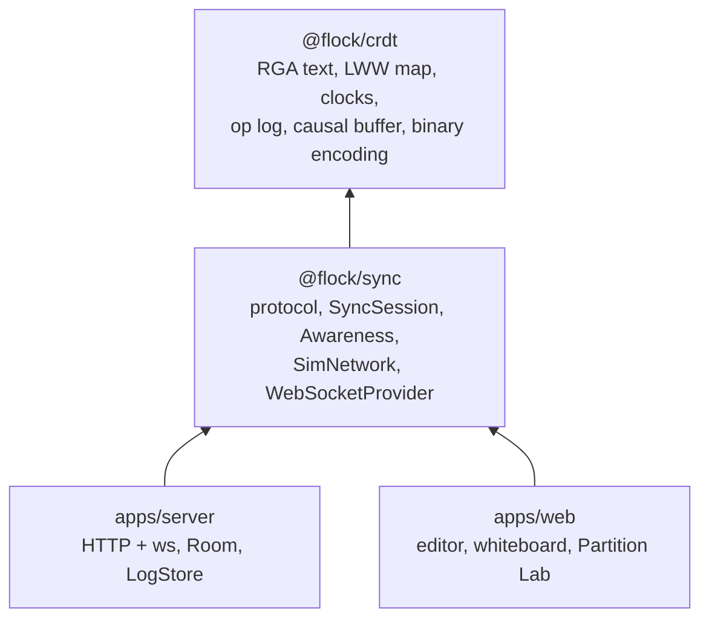
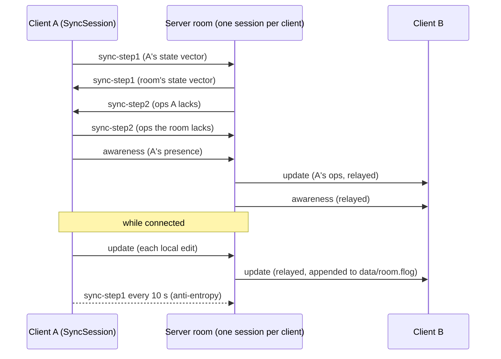

# Architecture

Flock is four layers, each depending only on the ones below it.



`@flock/crdt` has no runtime dependencies and no platform APIs (it carries its own UTF-8 codec), so
the same code runs in the browser, in Node and in the tests. `@flock/sync` is transport-agnostic:
a session only needs a `send(bytes)` function and someone calling `receive(bytes)`.

## One keystroke, end to end

1. **Textarea to operation.** `TextAreaBinding` compares the textarea's previous and new value
   (`diffSplice`), using the caret to place the edit correctly inside runs of equal characters, and
   calls `text.insert(index, 'x')`.
2. **Local integration.** `TextType.insert` finds the visible item before `index`, which becomes the
   origin. `Doc.local` assigns the next id `(replica, seq)` and Lamport time, integrates the insert
   into the RGA, appends it to the per-replica op log, advances the state vector and emits an
   `update` event carrying the operation (and its binary encoding on demand).
3. **Session.** The client's `SyncSession` receives the event. If the socket is open it sends an
   `update` message; otherwise the operation goes to the outbox.
4. **Server.** The room's session for that client decodes the message and calls
   `doc.applyUpdate(bytes, session)`. Newly integrated operations raise the room doc's `update`
   event: the room appends the encoded update to its log, and every other client session forwards
   it (each session skips updates whose origin is itself).
5. **Remote integration.** The other client's `Doc` applies the update, or buffers it if a
   dependency is missing (its session then sends a `sync-step1` within 50 ms to fetch the gap).
   The `change` event makes the binding replace the textarea value and restore the local selection
   from its relative positions; `RemoteCursors` redraws remote carets on the next animation frame.



## The document

`Doc` owns:

- a Lamport clock and a state vector (`VectorClock`, replica to highest integrated `seq`);
- the op log, `Map<replica, Op[]>`, each list contiguous in `seq`. It is the source of truth: the
  full state is `encodeUpdate(opsSince(empty vector))`, and a delta is `opsSince(theirVector)`,
  found by binary search per replica;
- a pending buffer, `Map<replica, Map<seq, Op>>`, for operations that are not ready yet;
- the shared types by name: `TextType` over an `Rga`, `MapType` over an `LwwMap`.

There are three operation kinds:

| Kind  | Occupies             | Fields                                             |
| ----- | -------------------- | -------------------------------------------------- |
| `ins` | k ids for k code pts | `origin` (id or null), `content`                   |
| `del` | 1 id                 | `ranges`: runs `(replica, seq, len)` of target ids |
| `set` | 1 id                 | `key`, `value` (JSON, or undefined for delete)     |

An operation is ready when its `seq` is exactly one more than the state vector entry of its replica
and its dependencies are covered (the origin for `ins`, every range end for `del`). After each
integration the buffer is drained in a loop until nothing more becomes ready. `applyOps` validates
the whole batch first (ids, Lamport times, well-formed strings, JSON values, type-kind consistency,
no partial overlap with known history) and throws `InvalidOpError` before changing anything.

### RGA details

Items form a doubly linked list behind a sentinel head, indexed by `Map<replica, Map<seq, Item>>`
for O(1) lookup by id. Integration of an item `x` with origin `o`:

```
ref = o
while ref.next exists and stamp(ref.next) > stamp(x): ref = ref.next
insert x after ref
```

where `stamp = (lamport, replica)`. Every item has a larger stamp than its origin (Lamport), and
siblings already in the list are in descending stamp order, so everything after `o` with a larger
stamp than `x` belongs to a sibling that sorts before `x` or to that sibling's subtree. The first
item with a smaller stamp is either a later sibling or lies outside `o`'s subtree; `x` goes before
it. This is the tree order of RGA without building the tree.

Local edits need offsets, not ids. A position marker (the last edited visible item and its offset)
makes sequential typing O(1); remote integrations clear it. Random-position local edits walk from
the marker, which is the linear cost noted in the README.

## Binary formats

Varints are unsigned LEB128 up to 2^53 - 1; signed values use a sign bit in the first byte.
Strings are length-prefixed UTF-8, validated strictly on decode (no overlong forms, no surrogates).

```
update  = version:u8 (=1)  strings  groups
strings = count  string*                       replica ids and type names
groups  = count  group*
group   = replica:strIdx  firstSeq  opCount  op*
op      = header:u8  [lamportGap]  [target:strIdx]  body
```

Header bits 0-1 are the kind. Bit 2 means "same target as the previous op", bit 3 "Lamport time is
the previous op's last time plus one", bit 4 "origin is the previous id of this replica", bit 5 is
"origin is the start of the text" for inserts and "delete the key" for sets. Sequence numbers are
implicit inside a group. JSON values use one-byte tags (null, false, true, int, float64, string,
array, object), are limited to depth 64, and collection counts are checked against the remaining
input before anything is allocated.

Protocol messages are one type byte followed by a state vector, an update, or awareness entries
`(replica, clock, state | null)`.

The server log is `"FLOG" 0x01` followed by records `[u32 length LE][u32 crc32 LE][update]`.
Opening a log stops at the first record that is truncated or fails its checksum and truncates the
file there. Compaction writes `room.flog.tmp`, fsyncs it, and renames it over the log.

## Failure handling

| Situation                               | Behaviour                                                   |
| --------------------------------------- | ----------------------------------------------------------- |
| Message lost or delayed                 | anti-entropy step 1; early step 1 when the buffer has a gap |
| Message duplicated or reordered         | dropped by id, or buffered until its dependencies arrive    |
| Client offline                          | outbox flushed on reconnect, state vectors fill the rest    |
| Server restarts                         | providers reconnect with backoff (250 ms doubling to 8 s)   |
| Crash during an append                  | torn record cut off when the log is reopened                |
| Malformed frame from a client           | that connection closes with 1007; others are unaffected     |
| Text frame                              | closed with 1003                                            |
| Invalid room name (path traversal etc.) | HTTP 400 before the upgrade                                 |
| Client disappears without closing       | ping/pong every 30 s; awareness entries time out after 30 s |

## Web app

The editor is vanilla TypeScript; no UI framework. `TextAreaBinding` and `RemoteCursors` drive a
plain `<textarea>` plus an overlay, measuring caret rectangles with a hidden mirror element. The
whiteboard draws on a canvas in a fixed 1600 by 1000 board space and stores every finished shape as
one map entry; incoming shapes are validated (`parseShape`) because peers are not trusted. Strokes
are simplified with Ramer-Douglas-Peucker before they are stored.

The Partition Lab is the same `Doc` and `SyncSession` code on a `SimNetwork`: per-link latency,
jitter, loss, duplication and partitions on a seeded generator. With a `VirtualScheduler` the same
simulator runs the property tests deterministically; the lab uses real timers.

## Testing strategy

Unit tests cover each module's contract and its malformed inputs. Property tests (fast-check) check
the algebraic claims: convergence under arbitrary delivery, idempotence, commutativity, and
agreement with a string model. The simulator turns network faults into reproducible test cases, and
one integration test runs the real server with real WebSocket clients through disconnects and
restarts. Mutation checks during development (breaking the tie-break, disabling anti-entropy)
confirmed that the property tests fail when the guarantees are broken.
